<div align="center">

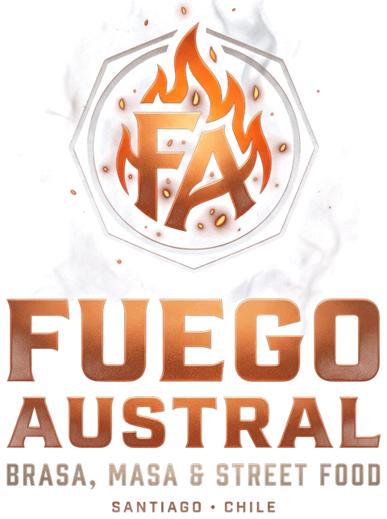

# Fuego Austral

**Brasa viva. Sabor sin filtros.**

Site cinematográfico para uma marca fictícia de street food em Santiago, Chile.<br>
Um hambúrguer que se monta camada por camada conforme você rola a página.

<br>

<a href="https://jhosuetortolero-lgtm.github.io/fuego-austral/"></a>


<br><br>

<a href="https://jhosuetortolero-lgtm.github.io/fuego-austral/">
  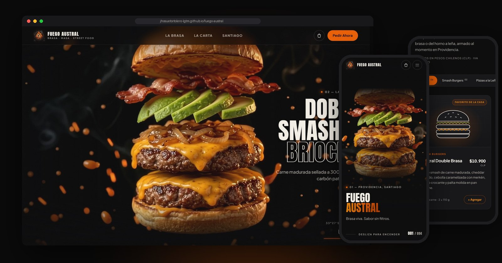
</a>

</div>

<br>

## ✦ Sobre o projeto

**Fuego Austral** é um conceito de portfólio no estilo dos sites premiados do Awwwards: uma hamburgueria
de brasa, masa madre e completos chilenos em Providencia, Santiago. Todo o conteúdo do site está em
espanhol do Chile — *La Carta*, *palta fresca*, preços em `$CLP`.

O centro da experiência é uma sequência de **94 fotogramas** desenhada num `<canvas>` e sincronizada com
o scroll. Enquanto o hambúrguer se monta, três blocos de texto contam a história da marca.

<div align="center">
  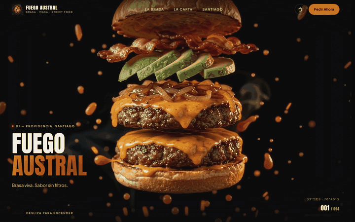
  <sub>Gravação real do hero rolando — quadros capturados do próprio site.</sub>
</div>

<br>

## ✦ Destaques

| | |
|---|---|
| 🎬 **Scroll-scrubbing em canvas** | 94 frames WebP sincronizados com GSAP ScrollTrigger (`scrub: 0.5`) numa seção fixa de 400vh |
| ⚡ **Carregamento inteligente** | Frame 0001 primeiro, depois 1 a cada 4 (cobertura rápida), o resto em segundo plano |
| 📱 **Frames por tela** | 1920px no desktop, 1280px no celular — download cai de 8,7 MB para 4,4 MB |
| 🖤 **Fusão perfeita com o fundo** | Composição `lighten` eleva o preto dos frames para `#0A0A0B`, sem borda visível |
| 🍔 **Cardápio interativo** | Filtros por categoria com animação **GSAP Flip** e indicador deslizante |
| 🛒 **Carrinho lateral** | Soma em CLP (`$10.900`), quantidade, persistência no navegador e confirmação de pedido |
| 🕐 **Horário de Santiago ao vivo** | "Abierto ahora / Cerrado" calculado no fuso `America/Santiago`, inclusive após meia-noite |
| 🧈 **Rolagem sedosa** | Lenis integrado ao ticker do GSAP |
| ♿ **Acessível** | Teclado, foco preso nos overlays, `inert`, contraste AA e `prefers-reduced-motion` |

<br>

## ✦ Galeria

<table>
  <tr>
    <td width="50%">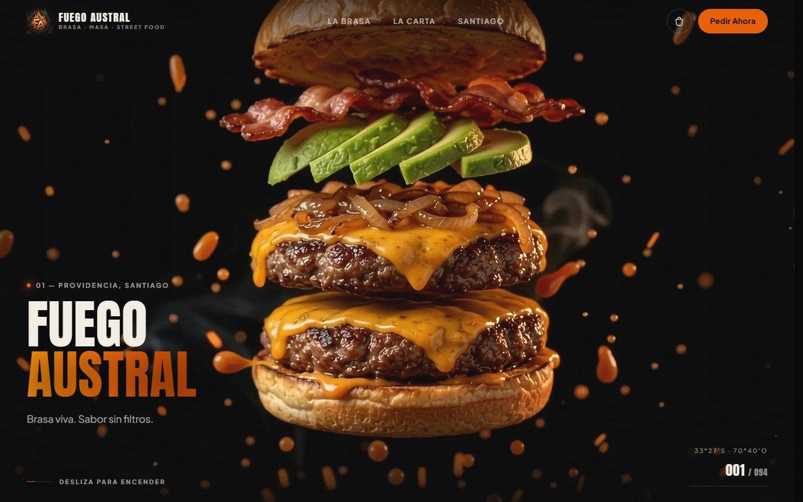<br><sub><b>01 · Hero</b> — Brasa viva. Sabor sin filtros.</sub></td>
    <td width="50%">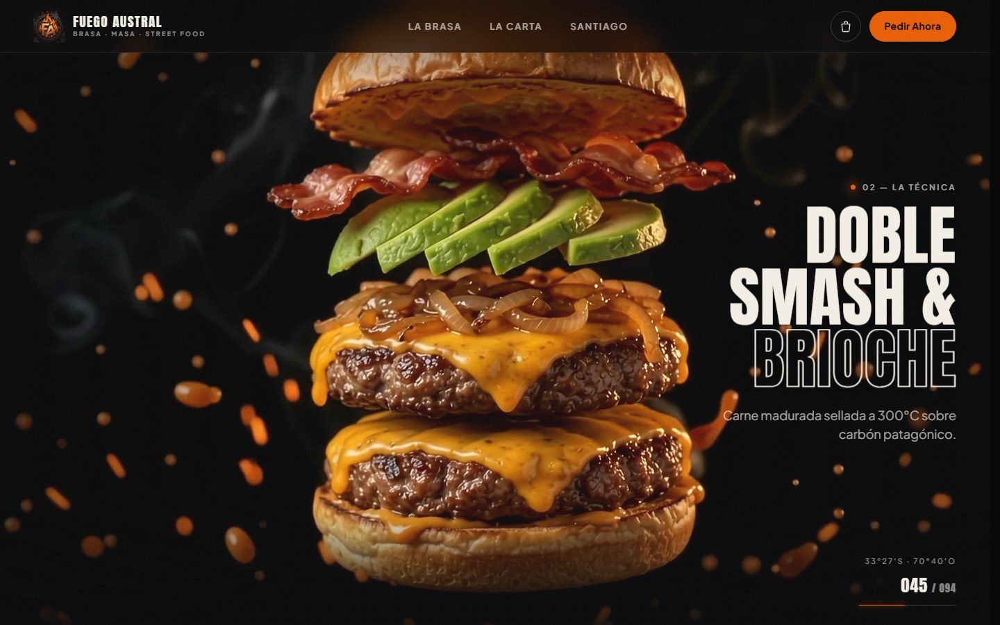<br><sub><b>02 · La Técnica</b> — carne sellada a 300°C</sub></td>
  </tr>
  <tr>
    <td>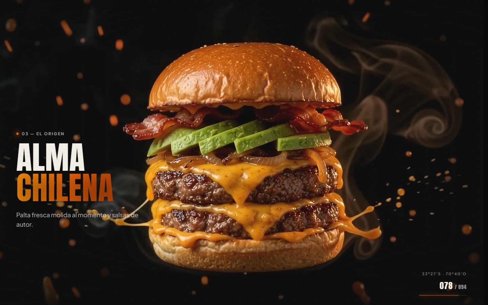<br><sub><b>03 · El Origen</b> — palta fresca molida al momento</sub></td>
    <td>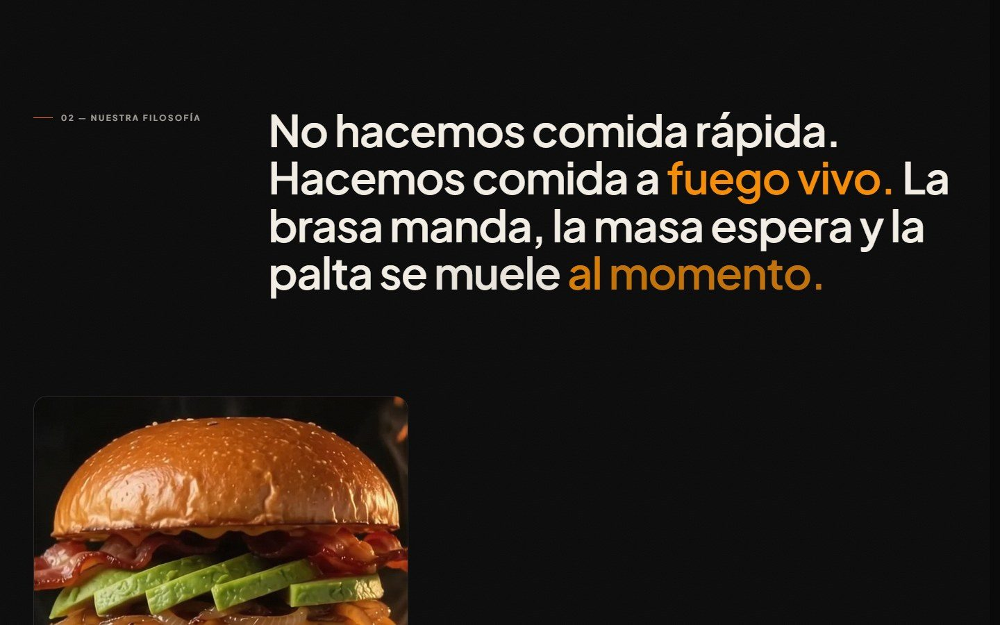<br><sub><b>Nuestra Filosofía</b> — manifesto revelado palavra a palavra</sub></td>
  </tr>
  <tr>
    <td>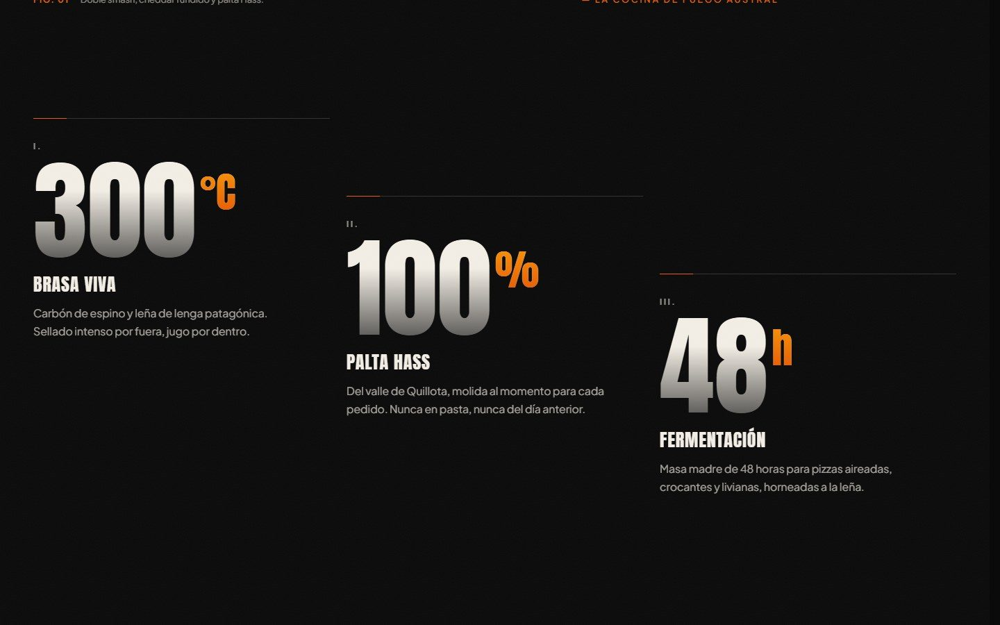<br><sub><b>La Brasa</b> — números com contagem animada</sub></td>
    <td>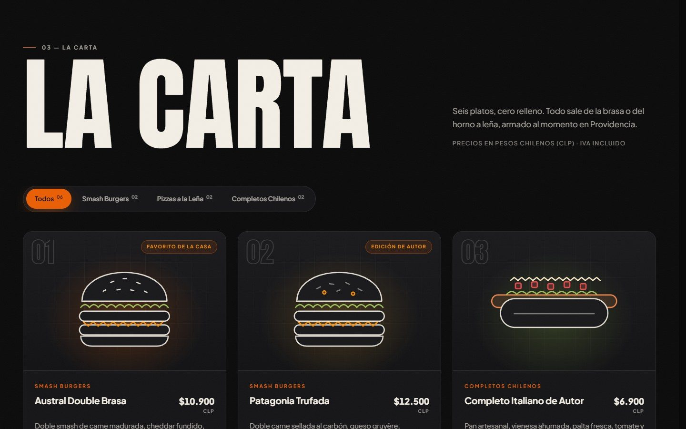<br><sub><b>La Carta</b> — filtros e cards premium</sub></td>
  </tr>
  <tr>
    <td>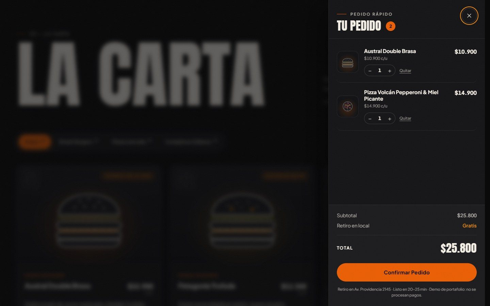<br><sub><b>Tu Pedido</b> — carrinho com total em CLP</sub></td>
    <td>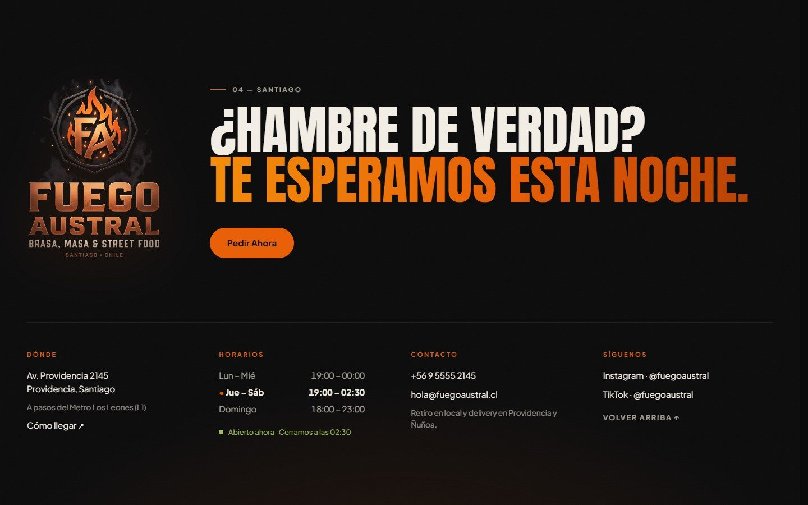<br><sub><b>Santiago</b> — horários, contato e tipografia gigante</sub></td>
  </tr>
</table>

<br>

## ✦ No celular

<div align="center">
  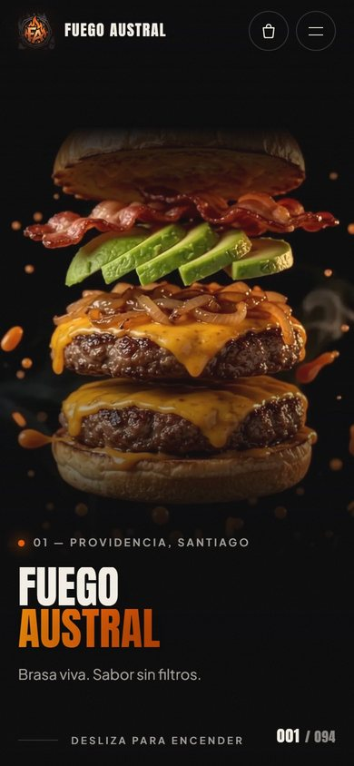&nbsp;
  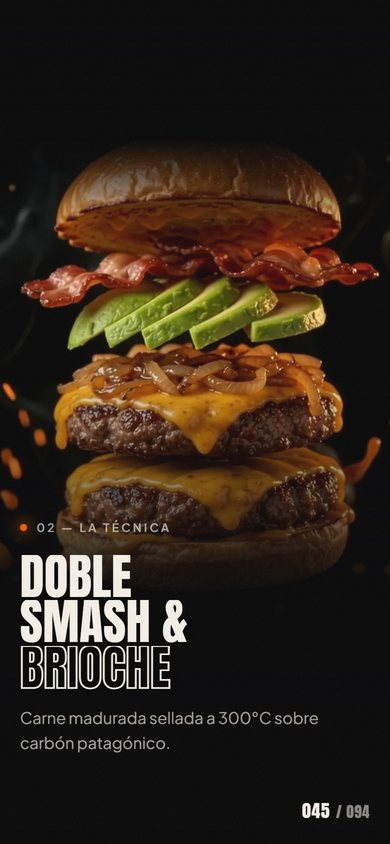&nbsp;
  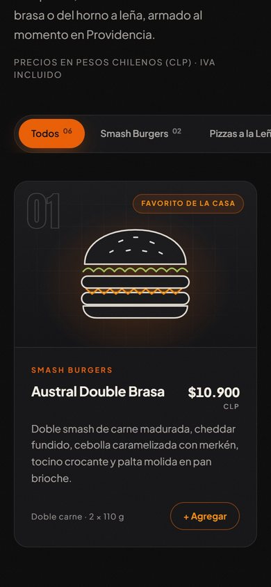&nbsp;
  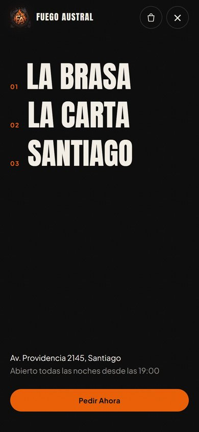
</div>

<br>

## ✦ Design system

<table>
  <tr>
    <td></td><td><b>Obsidiana</b></td><td><code>#0A0A0B</code></td><td>Fundo principal — funde com os frames</td>
  </tr>
  <tr>
    <td></td><td><b>Superfície</b></td><td><code>#141416</code></td><td>Cards e painéis · borda <code>rgba(255,255,255,.08)</code></td>
  </tr>
  <tr>
    <td></td><td><b>Brasa</b></td><td><code>#E85D04</code></td><td>Cor primária, CTAs</td>
  </tr>
  <tr>
    <td></td><td><b>Ember</b></td><td><code>#F48C06</code></td><td>Destaque e hover</td>
  </tr>
  <tr>
    <td></td><td><b>Bone</b></td><td><code>#F2EDE4</code></td><td>Texto (branco quente)</td>
  </tr>
</table>

**Tipografia** — [Anton](https://fonts.google.com/specimen/Anton) em caixa alta para títulos de impacto ·
[Plus Jakarta Sans](https://fonts.google.com/specimen/Plus+Jakarta+Sans) para textos e cardápio.

<br>

## ✦ Stack

| Camada | Tecnologia |
|---|---|
| Estrutura | HTML5 semântico, `lang="es-CL"` |
| Estilo | Tailwind CSS 3.4 (compilado, 7 KB) + CSS próprio com tokens da marca |
| Animação | GSAP 3.12 · ScrollTrigger · Flip |
| Rolagem | Lenis 1.1 |
| Imagens | Sequência WebP (desktop + mobile), logo com fundo transparente |
| Hospedagem | GitHub Pages — site 100% estático, sem build obrigatório |

<br>

## ✦ Rodar localmente

```bash
git clone https://github.com/jhosuetortolero-lgtm/fuego-austral.git
cd fuego-austral
python -m http.server 5173
# abrir http://127.0.0.1:5173
```

Sem Python? `npx serve -l 5173 .` também funciona.

<br>

## ✦ Estrutura

```
fuego-austral/
├── index.html              todas as seções
├── css/
│   ├── styles.css          tokens da marca + componentes
│   └── tailwind.css        gerado (npm run build:css)
├── js/
│   ├── data.js             cardápio: pratos, descrições e preços em CLP
│   └── main.js             loader, canvas, animações, filtros e carrinho
├── public/
│   ├── frames/             94 frames 1920×1080
│   ├── frames-mobile/      94 frames 1280×720
│   └── brand/              logo, favicons e imagem de compartilhamento
└── docs/                   imagens do README e relatório de auditoria
```

<br>

## ✦ Personalizar

- **Cardápio e preços** → edite só `js/data.js`. Cards, filtros e carrinho se atualizam sozinhos.
- **Ritmo do hero** → `CONFIG` no topo de `js/main.js` (`scrub`, `criticalStep`, `portraitFit`).
- **Novas classes Tailwind** → `npm install` uma vez, depois `npm run build:css`.
- **Outra sequência de frames** → troque as pastas em `public/` mantendo `frame_0001.webp…` e ajuste `frameCount`.

<br>

## ✦ Qualidade

Auditado antes da publicação — fluxo completo, teclado, movimento reduzido, 390px e cliques rápidos nos
filtros. Achados, evidências e correções em [`docs/auditoria-site.md`](docs/auditoria-site.md).

<br>

---

<div align="center">

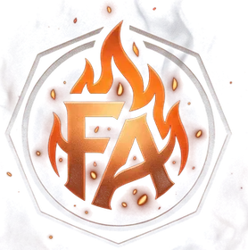

**Fuego Austral** é uma marca fictícia criada para portfólio.<br>
Telefone, e-mail e redes sociais exibidos no site são exemplos.

Feito por [@jhosuetortolero-lgtm](https://github.com/jhosuetortolero-lgtm)

</div>
